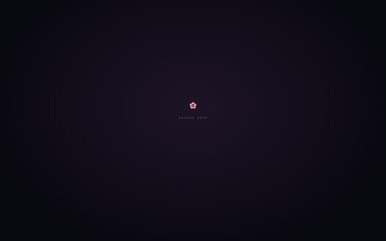

# 小葵 OS · Codex 启动动画

**用自己的 Logo 和创意，为 Codex 做一段属于自己的开场。**

A customizable, code-rendered Windows startup animation for the Codex desktop app. Built with C# / WPF, with a fixed 12.5-second timeline and a layered handoff to the real application.



[下载 Windows 成品](https://github.com/AriaEternity/xiaokui-codex-boot/releases/latest) · [查看制作与定制指南](docs/CUSTOMIZATION.md) · [从创意开始](docs/CREATIVE-GUIDE.md) · [参考与致谢](THIRD_PARTY_NOTICES.md)

预览展示开场与字幕片段；实际运行时，最后的透明过渡会显露下方已经启动的真实 Codex 窗口。

## 它做什么

- 双击独立入口，同时播放动画并启动官方 Codex；已有窗口会复用。
- 默认居中在鼠标所在屏幕，保持置顶并与客户端窗口对齐，支持移动、缩放、最大化与还原。
- 固定 **12.5 秒**时间轴，四句字幕、提示音与进度条同步。
- 最后两秒让装饰、字幕、Logo、背景依次退场；窗口及真实客户端保持固定比例，不整体放大。
- `Esc`、`Enter`、空格可跳过；`M` 或「音效」切换声音。
- 提供独立动画预览，不需要先打开 Codex。

这是独立社区项目，与 OpenAI 无隶属关系。它提供额外启动入口，不修改官方应用包、账号或聊天，也不安装常驻服务或设置 Windows 开机自启。

## 下载即用

1. 从 [Releases](https://github.com/AriaEternity/xiaokui-codex-boot/releases/latest) 下载 `xiaokui-codex-boot-v1.5.0-win-x64.zip`，解压到固定目录。
2. 双击 **`小葵OS · Codex.exe`**。
3. 只看动画时，双击 **`小葵OS · 动画预览.exe`**。
4. 可以右键启动 EXE 自行创建桌面快捷方式；从该入口打开才会播放动画。

需要 Windows 10/11 x64、.NET Framework 4.8，以及官方商店版 Codex。播放动画无需 Python、Node.js、FFmpeg、AI API Key 或管理员权限。两个 EXE 内置 Logo 与声音。

目前使用的官方应用标识为 `OpenAI.Codex_2p2nqsd0c76g0!App`。其他安装渠道、未来客户端版本或多窗口情形需要重新验证识别与交接。

## 时间轴与进度

| 时间 | 阶段 |
|---|---|
| 0–2.5 秒 | 小葵，正在醒来。 |
| 2.5–5 秒 | 初始化界面 |
| 5–7.5 秒 | 准备工作空间 |
| 7.5–10.5 秒 | 欢迎回来 |
| 10.5–12.5 秒 | 分层退场，显露真实 Codex |

进度条从开场持续推进，12.2 秒到达 100%，最后 0.3 秒完成退场。它表示**动画与窗口交接进度**，不表示 Codex 内部的实际加载百分比。

12.5 秒从动画首次播放开始计算，不包含程序装载时间；Windows 调度有毫秒级误差。窗口未出现、未响应或最小化均不暂停计时。截止时 Codex 如果仍在加载，会显示官方客户端自己的加载界面。用户主动跳过可提前结束。

## 动画怎样生成

Logo 是作者通过 ChatGPT 生成的静态透明 PNG；动画由作者提出需求、通过 Codex 协作编写与调试，使用 **C# / WPF / .NET Framework 4.8 实时绘制**。代码根据图片的颜色与透明度采样色块，完成像素汇聚、扫描线、圆弧、粒子、字幕和透明过渡。

提示音由 Python 合成并内置为 WAV。Python 与 Pillow 只用于素材准备和构建，最终动画运行时不调用 AI 服务。详细说明见 [实现原理](docs/ARCHITECTURE.md)。

## 做成你自己的版本

小葵只是示例。欢迎设计自己的角色、品牌、配色、字幕、声音和分镜。

- **更换 Logo**：替换 `assets/logo.png`，使用透明背景 PNG，然后重新构建。
- **更换主题与节奏**：修改绘制与时间轴代码，再重新构建；任意新动画并不会仅凭替换图片自动生成。
- **用 AI 协助创作**：[创意指南](docs/CREATIVE-GUIDE.md) 提供分镜方法与可直接修改的提示词。
- **具体改哪里**：[定制指南](docs/CUSTOMIZATION.md) 标注图片、字幕、颜色、时长、提示音和窗口逻辑的入口。

## 从源码构建

使用 64 位 Windows、Python 3.10 或更高版本，以及系统 .NET Framework 4.8 编译工具。

```powershell
python -m pip install -r requirements-build.txt
python build.py
```

输出到 `build/XiaokuiCodexBoot/`。素材、源码和工具均使用仓库相对路径，不读取个人 Downloads 目录。

```powershell
# 检查固定时长、进度、置顶、对齐、延迟及缺席窗口；会显示专用测试窗口
python tests/run-tests.py

# 为自己构建的版本生成带许可及说明的分发包
python package.py
```

分发包和 SHA-256 写入 `dist/`。构建依赖为锁定的 Pillow 12.2.0（MIT-CMU），不随运行 EXE 分发。原生窗口验收边界见 [验证记录](docs/VALIDATION.md)。

## 隐私与移除

启动器不读取聊天、账号或画面，不提供网络遥测。`logs/` 只记录播放阶段、窗口信息与错误；这些仍可能包含本机环境信息，提交 Issue 前请自行检查。不要上传真实聊天、凭据或整份个人日志。

删除自己创建的快捷方式和解压目录即可移除；官方客户端继续使用原有入口。

## 许可与参考

代码及作者有权许可的示例素材使用 [MIT License](LICENSE)。AI 图像来源及权利范围见 [ASSETS.md](ASSETS.md)。参考项目地址、具体参考内容和保留的许可声明见 [THIRD_PARTY_NOTICES.md](THIRD_PARTY_NOTICES.md)。

本项目欢迎你使用自己的创意。保留许可证要求的声明，同时自由设计属于你的版本。
